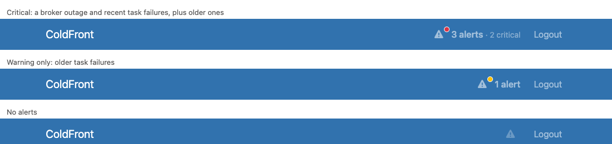
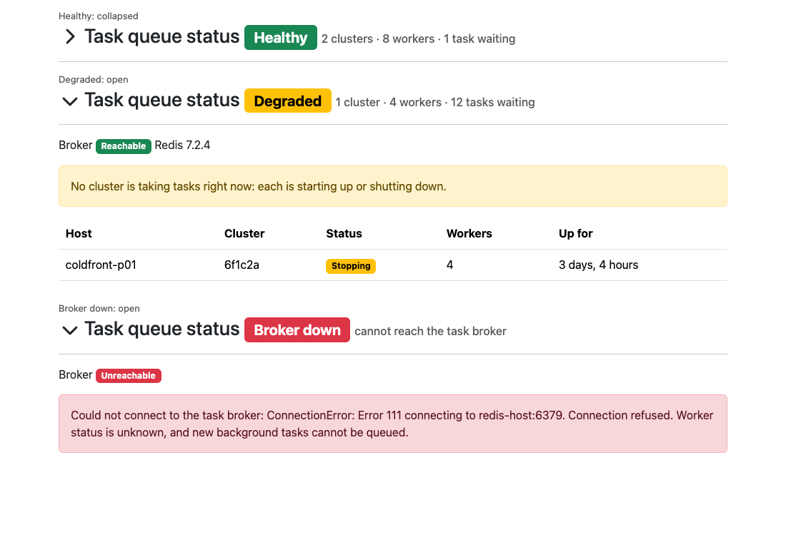

# Admin alerts, task queue health and failed tasks

Staff and superusers see an alerts indicator in the navbar. It counts the current alerts
and links to a page that lists them. Alerts come from two sources so far: the django-q task
queue's health, and failed background tasks that nobody has acknowledged.

This describes what is built. Alerts for other audiences, such as PIs, Approvers and project
members, are planned in [alert-audiences-plan.md](alert-audiences-plan.md) but not built.

## What's implemented

### For staff and superusers

| Where | What they see |
| --- | --- |
| Navbar, every page | A warning triangle (`fa-triangle-exclamation`) with a dot in the worst alert's colour, then "N alerts". If any alert is critical, it adds "· N critical". With no alerts, the triangle is dimmed and has no dot or count. Hovering shows each alert's title. Clicking opens the alerts page. It refreshes every 30 seconds while the tab is visible. |
| `/alerts/` | Every current alert, worst first, with its severity (Critical, Warning or Info), title, detail, source, and a Details button when it has a link. Alerts that can be acknowledged also have an Acknowledge button, with an optional reason. With no alerts: "There are no alerts to display." |
| `/task-summary/` | A "Task queue status" panel above the task counts. It is collapsed while the queue is healthy and open otherwise. It shows the broker's state and every cluster heartbeat: host, cluster id, status, workers and uptime. |
| `/task-report/` | Besides each failure's Ack button, an "Acknowledge all shown" button, with an optional reason. It acknowledges every unacknowledged failure matching the report's filters, as of when the page loaded. |
| Admin and Staff menus | "Background Tasks", a link to `/task-summary/`. |

Ordinary users see none of this. The navbar item, the two alert views and the task pages are
all limited to staff and superusers.

The navbar indicator with critical alerts, with only a warning, and with none:



The task queue panel when healthy (collapsed), degraded and with the broker down:



### Alert sources

| Source | Severity | Raised when | Links to |
| --- | --- | --- | --- |
| `task queue` | Critical | The task broker (Redis) can't be reached ("Task queue: broker down"), or it can but no cluster has sent a heartbeat ("Task queue: no workers"). | `/task-summary/` |
| `background tasks` | Critical | Unacknowledged, non-ignored failures in the last `TASK_RECENT_WINDOW_HOURS` ("Background tasks: 3 failed in the last 24 hours"). | `/task-report/` |
| `background tasks` | Warning | Unacknowledged, non-ignored failures older than that, back as far as `TASK_FAILURE_ALERT_DAYS` ("Background tasks: 2 earlier failures not acknowledged"). | `/task-report/` |

- A queue that is only degraded, with a cluster starting up or shutting down, raises no
  alert. It shows on the panel only, because it usually sorts itself out within seconds.
- An `IgnoredTask` rule keeps matching tasks out of the alerts, the same way it does on the
  task pages.
- Acknowledging a failure clears it from the alerts. That can be done one task at a time on
  the task report, for everything shown there, or from a task alert's Acknowledge button,
  which covers exactly the failures that alert counted. All three create `TaskAcknowledgement`
  records, so the task pages and the alerts always agree.
- The queue alerts have no Acknowledge button. They clear by themselves once the queue is
  working again.
- Task alerts carry counts only, never a task's name, arguments or result.
- If a source raises an exception, or returns something other than `Alert`s, it becomes a
  warning of its own, "Could not check <source>", with the error. The other sources still
  show, and the failure is logged with its traceback.

### Settings

| Setting | Default | Meaning |
| --- | --- | --- |
| `TASK_RECENT_WINDOW_HOURS` | 24 | How far back counts as recent: the critical task alert's window, and the part of the task summary listed in full. A whole number of hours, at least 1. |
| `TASK_FAILURE_ALERT_DAYS` | 7 | How far back the warning task alert counts older failures. A whole number of days, at least 1, or `None` for no limit. |

Both are read on every check, so changing one needs no code change. A Django system check
(`checks.py`, `tufts_local.E001` and `E002`) rejects bad values, so a typo stops
`manage.py check` and `migrate` at deploy time. In coldfront-ansible, set them through
`coldfront_settings`.

coldfront-ansible also sets `socket_connect_timeout: 3` on the Redis connection
(`local_settings.py.j2`). Without it, a Redis host that drops packets instead of refusing
connections would make each queue check wait indefinitely.

## Architecture


```text
 Browser (staff / superuser)
 ┌───────────────────────────────────────────────────────────────────────────┐
 │ navbar on every page (coldfront-branding authorized_navbar.html)          │
 │   [▲ N alerts] ─── htmx every 30s ──▶ /alert-indicator/                   │
 │                          click ──────▶ /alerts/                           │
 │   Admin / Staff menu ── Background Tasks ──▶ /task-summary/               │
 │   /task-summary/ ── queue status panel, collapsed while green             │
 └───────────────────────────────────────────────────────────────────────────┘
                 │                                │
                 ▼                                ▼
  views/alerts.py                        views/task_summary.py
  alert_indicator, alert_list            task_summary (+ queue_health in context)
                 │                                │
                 ▼                                │
  alerts.py                                       │
  get_current_alerts()  ── reuses a run for 15s   │
  collect_alerts()                                │
   ├─ runs each registered source in try/except   │
   ├─ a source that crashes → "Could not check X" │
   └─ sorts danger → warning → info               │
                 │                                │
       ┌─────────┴─ registry of sources ─────────────────────────┐
       │ 'task queue'       → queue_health.task_queue_alerts()   │
       │ 'background tasks' → task_failures.task_failure_alerts()│
       └─────────┬───────────────────────────────────────────────┘
                 ▼                                │
  queue_health.py                                 │
  task_queue_alerts()  ── alerts only if red      │
  get_task_queue_health() ◀───────────────────────┘
   ├─ broker.queue_size() (also the reachability check), info()
   └─ Stat.get_all()  reads signed heartbeats
                 │
                 ▼
  Redis (queue db) ◀── heartbeat every ~0.5s, 3s expiry ──┐
                                                          │
           qcluster on web host        qcluster on any other host
           (same Q_CLUSTER name, SECRET_KEY and Redis db)
```

A cluster on another host appears only if it shares the Redis database, the
`Q_CLUSTER` name and the `SECRET_KEY`. Heartbeats are signed with `SECRET_KEY`, and
django-q silently skips any it can't verify, so a cluster with a different key looks the
same as one that isn't running.

## Domain objects

### `Alert`

A frozen dataclass in `alerts.py`.

| Field      | Type                               | Notes                                                       |
| ---------- | ---------------------------------- | ----------------------------------------------------------- |
| `severity` | `'danger'`, `'warning'` or `'info'` | Also the Bootstrap colour. Any other value raises `ValueError`. |
| `title`    | `str`                              |                                                             |
| `detail`   | `str`                              |                                                             |
| `link`     | `str`                              | Where to go to act on the alert.                            |
| `source`   | `str`                              | Filled in by `collect_alerts()`.                            |

`severity_label` gives the display name, "Critical", "Warning" or "Info", from
`SEVERITY_LABELS`. That mapping also fixes the order, worst first: `SEVERITIES` is built
from it.

### `QueueHealth`

A frozen dataclass in `queue_health.py`.

- **Fields:** `broker_ok`, `broker_error`, `broker_info`, `queued` and `clusters` (a
  list of `ClusterStatus`).
- **`overall_ok`:** true only when `state` is `healthy`.
- **`summary`:** the line shown beside the panel's badge, such as "2 clusters · 8 workers ·
  1 task waiting".
- **`state`, `label` and `severity`:** one table, `_STATES`, maps each state to its label
  and colour, worst first:

| `state`       | `label`     | `severity` |
| ------------- | ----------- | ---------- |
| `broker_down` | Broker down | `danger`   |
| `no_workers`  | No workers  | `danger`   |
| `degraded`    | Degraded    | `warning`  |
| `healthy`     | Healthy     | `success`  |

### `ClusterStatus`

A frozen dataclass in `queue_health.py`.

- **Fields:** `host`, `cluster_id`, `status`, `workers` and `started`.
- **`is_running`:** the status is Idle or Working and the cluster has at least one
  worker.
- **`severity`:** the badge colour. It's worked out from django-q's status labels, which
  are translated, so both properties compare them in the language of the current request.

## Design

**Live checks only.** No alert is stored, so the alerts add no model or migration. An alert
goes away by itself once its cause is fixed.

**Acknowledgement belongs to the source, not the alert.** An `Alert` can carry an `ack_url`,
and the alerts page shows an Acknowledge button that POSTs to it. What acknowledging means
is the source's decision:

- **`background tasks`:** its `ack_url` points at the bulk acknowledgement
  (`task-acknowledge-bulk/`), with the exact window the alert counted: `since` (inclusive)
  and `before` (exclusive), as ISO datetimes. `before` is the moment of the check, so a
  failure that arrives afterwards isn't acknowledged by mistake, even though the alert was
  cached for up to 15 seconds. The endpoint creates a `TaskAcknowledgement` per failure.
  So acknowledging from an alert, from the report's "Acknowledge all shown", and one task at
  a time are the same thing, recorded the same way.
- **`task queue`:** no `ack_url`. An outage should stay red until it is fixed.

There is no general alert-acknowledgement model. One would need a stable identity for each
alert and a rule for when it comes back, such as an expiry. Add it when a source has nothing
of its own to acknowledge. Acknowledging also clears the cached alerts in the process that
handled it, so the person who acted sees the alert go at once.

**Alert sources.** A source is any function registered with
`@register_alert_source('name')` that takes no arguments and returns a list of `Alert`. To
add a new type of alert, write a source in a module that `LocalConfig.ready()` imports.
`apps.py` does this for `queue_health` and `task_failures`. Test each source by calling it
directly: inside the alerts list, a bug in one shows up only as a "Could not check" warning.

**Alerts are checked at most every 15 seconds.** The navbar polls every 30 seconds from
every open staff tab, so the views read alerts through `get_current_alerts()`. Each
process keeps its last run of the sources in memory for `CACHE_SECONDS` (15), however many
tabs are polling, and the "as of" times show when that run happened. The cache isn't
Django's, because that lives in the same Redis the queue source checks on. The task summary
panel doesn't use the cache: it checks the queue fresh on each page view.

**A dead broker is answered at once.** redis-py retries a failed command 10 times by
default, which would make every check during an outage wait out 11 attempts. The health
check turns retries off on its own Redis client (`_get_broker_without_retries`). Enqueueing
keeps its retries, because `get_broker()` builds a new client on each call. The first
command, `queue_size()`, doubles as the reachability check, so there is no separate ping.

**Task failures share one set of rules.** `task_failures.py` owns "which failures still
need attention": the ignore list helpers and `unacknowledged_failures()`. The task summary,
the task report and the alert all use them, so the summary's counts explain the alert
rather than contradict it. The summary has two segments, split at
`TASK_RECENT_WINDOW_HOURS`: recent tasks, counted and listed in full, and older ones,
counted only.

## Changes

- **New in `tufts_local`:**
  - `alerts.py`, `queue_health.py`, `task_failures.py`, `checks.py` and `views/alerts.py`
  - URLs `alerts/` (`alert-list`), `alert-indicator/` (`alert-indicator`) and
    `task-acknowledge-bulk/` (`task-acknowledge-bulk`)
  - three templates: the navbar fragment, the alerts page and the queue status panel
- **Edited in `tufts_local`:**
  - `task_summary.html` now includes the panel
  - the task summary has two segments, split at `TASK_RECENT_WINDOW_HOURS`, instead of
    three fixed ones (more than 24 hours, 2 to 24 hours, the last 2 hours)
  - the ignore-list helpers moved from `views/task_report.py` to `task_failures.py`
  - `views/task_acknowledgement.py` has the bulk acknowledgement, and the per-task views
    clear the alert cache
  - the task report has "Acknowledge all shown"
  - the task summary view, `urls.py`, `views/__init__.py` and `apps.py` are updated to
    match
- **Removed from `tufts_local`:** the task status badge: the `task_summary_indicator`
  view, its `task-summary-indicator/` URL (and its `?format=json` output, which had no
  callers), and `_task_summary_indicator.html`.
- **coldfront-branding:**
  - `authorized_navbar.html` has the alerts `<li>` and no longer the task badge
  - `navbar_task_links.html` holds the Background Tasks menu link, included by
    `navbar_admin.html` and by a new override of ColdFront's `navbar_nonadmin_staff.html`
- **coldfront-ansible:** `socket_connect_timeout: 3` on the Redis connection in
  `local_settings.py.j2`.
- **Tests:**
  - `test_alerts.py`, `test_queue_health.py`, `test_task_failures.py` and
    `test_checks.py`, plus a `FakeBroker` in `fakes.py`. The bulk acknowledgement is tested
    in `test_task_acknowledgement.py`, and "Acknowledge all shown" in `test_task_report.py`.
  - A conftest fixture gives every test the fake broker automatically. Without it, each
    task summary render tried to reach Redis on localhost, and the suite slowed from 3s
    to 48s. Another clears the alert cache between tests.
  - The fake broker signs heartbeats the same way django-q does. So the tests cover a
    cluster on another host that uses a different `SECRET_KEY`: it is simply absent.

## Not built yet

- **Alerts for other audiences:** limiting a site-wide alert to superusers or reviewers,
  and project alerts for PIs, Approvers and project members. These are planned in
  [alert-audiences-plan.md](alert-audiences-plan.md).
- **Acknowledging alerts in general,** for sources with nothing of their own to acknowledge.
  See *Acknowledgement belongs to the source* above, and the last section of the audiences
  plan.
- **A retention limit for finished tasks.** This is proposal 3 in coldfront-ansible's
  `docs/tufts-local-issues.md`.
